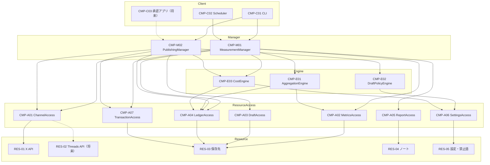

# 1. 概要設計

## 1.1 範囲

| 区分 | 内容 |
| --- | --- |
| 扱う | SNS のアカウントと投稿の数字の取得・保存・集計（UC-01）、下書きの検査・承認・投稿・記録（UC-02）、費用の見積もり・記録・上限（UC-03） |
| 扱わない | 下書きの文章を考えること（初期は Claude Code が行い、このシステムには完成した下書きを渡す。OPEN-06）。返信・いいね・フォローの自動化（NFR-10） |

## 1.2 変動性の分析（VOL）

軸は「利用者」（運営者の使い方が変わる）と「時間」（外の世界が変わる）。

| ID | 変動性 | 変わり方の例 | 軸 | 封じ込める構成要素 |
| --- | --- | --- | --- | --- |
| VOL-01 | チャネル | X → Threads → note・Instagram など | 利用者 | CMP-A01 ChannelAccess（チャネルごとの実装を差し替える） |
| VOL-02 | 各チャネルの API の仕様・認証方式・単価 | OAuth 1.0a → 2.0、エンドポイントの変更、値上げ | 時間 | CMP-A01 ChannelAccess（仕様・認証）、CMP-E03 CostEngine（単価） |
| VOL-03 | 取る数字の種類 | 項目の追加、本人だけの数字が取れる期間 | 利用者、時間 | CMP-A01 ChannelAccess（チャネル固有の名前を共通の項目名に揃える） |
| VOL-04 | 集計のルール | 月ごと → 週ごと、チャネルの比較、投稿の種類ごと | 利用者 | CMP-E01 AggregationEngine |
| VOL-05 | 下書きの検査ルール | 文字数・禁止語・URL → 重複・投稿の間隔 | 利用者、時間 | CMP-E02 DraftPolicyEngine |
| VOL-06 | 費用の計算と上限 | 単価の改定、為替、上限額の変更 | 時間、利用者 | CMP-E03 CostEngine |
| VOL-07 | 承認の場所 | Claude Code → スマホのアプリ | 利用者 | Client（CMP-C01 CLI → CMP-C03 承認アプリ） |
| VOL-08 | 動かす場所ときっかけ | Mac の定期実行（launchd）→ Google Cloud（Cloud Scheduler など）、手動 | 時間 | CMP-C02 Scheduler、CMP-A06 SettingsAccess（設定の置き場所） |
| VOL-09 | 保存先 | 手元の SQLite → クラウドの保存先（GCS のようなオブジェクトストレージ、データベースなど） | 時間 | CMP-A02 MetricsAccess、CMP-A03 DraftAccess、CMP-A04 LedgerAccess、CMP-A07 TransactionAccess |
| VOL-10 | 集計の書き出し先 | 運営者のノート（Markdown）→ ほかの表、ホームページ | 利用者 | CMP-A05 ReportAccess |
| VOL-11 | 認証情報の置き場所 | macOS キーチェーン → Secret Manager | 時間 | CMP-U01 Security |
| VOL-12 | ログの出し先 | ファイル → Cloud Logging | 時間 | CMP-U02 Logging |

## 1.3 変動性として扱わないもの

| 候補 | 扱わない理由 |
| --- | --- |
| 計測の流れ（取る → 保存 → 集計 → 書き出す） | このシステムの存在理由そのもの。チャネルや保存先が変わっても流れは変わらない |
| 投稿の流れ（下書き → 検査 → 承認 → 投稿 → 記録） | 「承認していない文章は出さない」（BR-03）を守るための骨格。承認の場所が変わっても流れは変わらない |
| 言語と道具（Python、uv、ruff、ty） | 運営者が決めた前提。変えるときは作り直す |
| 運営者が 1 人であること | 複数人での承認は、要件にない。必要になったら要件から見直す |

## 1.4 リソース（RES）

| ID | リソース | 状態 |
| --- | --- | --- |
| RES-01 | X API | 初期 |
| RES-02 | Threads API | 将来 |
| RES-03 | 保存先（初期：リポジトリの外の SQLite ファイル） | 初期 |
| RES-04 | 運営者のノート（Markdown のファイル） | 初期 |
| RES-05 | 設定（単価表・費用の上限・為替）と禁止語のファイル。どちらもリポジトリの外 | 初期 |
| RES-06 | 認証情報の保管場所（初期：macOS キーチェーン） | 初期 |
| RES-07 | ログファイル | 初期 |

## 1.5 階層構成（CMP）

| ID | 層 | 名前 | 責務 | 封じ込める変動性 | 状態 |
| --- | --- | --- | --- | --- | --- |
| CMP-C01 | Client | CLI | 運営者（と Claude Code）が使うコマンド：下書きの登録、承認、投稿、費用の確認、計測の手動実行 | VOL-07 | 初期 |
| CMP-C02 | Client | Scheduler | 計測を週 1 回起動する | VOL-08 | 初期 |
| CMP-C03 | Client | 承認アプリ | スマホから承認する | VOL-07 | 将来 |
| CMP-M01 | Manager | MeasurementManager | UC-01（週次の計測）と UC-03（費用の確認）の流れ | ― | 初期 |
| CMP-M02 | Manager | PublishingManager | UC-02（承認つきの投稿）の流れ | ― | 初期 |
| CMP-E01 | Engine | AggregationEngine | 時系列の数字から月ごとの集計と投稿の一覧を作る | VOL-04 | 初期 |
| CMP-E02 | Engine | DraftPolicyEngine | 下書きを検査する（文字数、禁止語、URL など） | VOL-05 | 初期 |
| CMP-E03 | Engine | CostEngine | 呼び出しの費用を見積もり、月の上限を超えるかを判定する | VOL-02（単価）、VOL-06 | 初期 |
| CMP-A01 | ResourceAccess | ChannelAccess | チャネルの数字を共通の項目名で取得し、投稿する。チャネルごとに実装する（初期：X） | VOL-01、VOL-02、VOL-03 | 初期（Threads は将来） |
| CMP-A02 | ResourceAccess | MetricsAccess | 取得した数字を時系列で保存し、読み出す | VOL-09 | 初期 |
| CMP-A03 | ResourceAccess | DraftAccess | 下書き・承認・投稿結果を保存し、読み出す | VOL-09 | 初期 |
| CMP-A04 | ResourceAccess | LedgerAccess | 費用の記録を保存し、月ごとの合計を読み出す | VOL-09 | 初期 |
| CMP-A05 | ResourceAccess | ReportAccess | 集計を書き出す | VOL-10 | 初期 |
| CMP-A06 | ResourceAccess | SettingsAccess | 単価表・上限・為替・禁止語を読み出す | VOL-08 | 初期 |
| CMP-A07 | ResourceAccess | TransactionAccess | 保存先への複数の書き込みを、まとめて確定する（すべて確定するか、どれも確定しないか） | VOL-09 | 初期 |
| CMP-U01 | Utility | Security | 認証情報を読み出す。ログやエラー文に出さない | VOL-11 | 初期 |
| CMP-U02 | Utility | Logging | 実行の記録（成功・失敗）を残す | VOL-12 | 初期 |
| CMP-U03 | Utility | Clock | 現在時刻を返す（テストで固定するため） | ― | 初期 |

Utility（CMP-U01〜U03）はすべての層から使うため、図では省く。CMP-U01 は RES-06、CMP-U02 は RES-07 を使う。

## 1.6 利用規則

The Method の呼び出しの規則に従う。CI のアーキテクチャテスト（TC-A）で検査する。

| # | 規則 |
| --- | --- |
| 1 | Client は Manager だけを呼ぶ |
| 2 | Manager は Engine と ResourceAccess を呼ぶ。Manager どうしは呼ばない |
| 3 | Engine は ResourceAccess を呼んでよい。Engine どうしは呼ばない |
| 4 | ResourceAccess はリソースだけを使う。ResourceAccess どうしは呼ばない |
| 5 | 上の層を呼ばない（下から上への呼び出しはない） |
| 6 | Utility はどの層からも使ってよい。Utility は他の層を呼ばない |
| 7 | ResourceAccess の操作は業務の言葉で表す（例：「投稿する」「今月の費用の合計」）。CRUD やチャネル固有の名前を上の層に見せない |

## 1.7 コアユースケースによる検証

構成要素の分け方で、コアユースケースが流れることを確かめる（詳しいコールチェーンは 02b）。

| UC | 流れ |
| --- | --- |
| UC-01 週次の計測 | C02 → M01 → E03（残りの予算）→ A01（数字の取得）→ A02（保存）→ A04（費用の記録）→ E01（集計。A02 と A04 を読む）→ A05（書き出し） |
| UC-02 承認つきの投稿 | 登録：C01 → M02 → E02（検査）→ E03（費用の見積もり）→ A03（下書き）。承認：C01 → M02 → A03（承認の記録）。投稿：C01 → M02 → A03（承認済みの下書き）→ E02（送信直前の再検査、NFR-04）→ E03（上限の判定）→ A01（投稿）→ A03（結果）→ A04（費用） |
| UC-03 費用の確認 | C01 → M01 → E03（今月の合計と残り）→ A04 |

### 変動性シナリオ（変わったときに直す場所）

| 変化 | 直す場所 | 直さない場所 |
| --- | --- | --- |
| Threads を足す（VOL-01） | A01 に Threads の実装を足し、E03 の単価表と E02 のルールにチャネルを足す | Manager、Client、保存先 |
| Google Cloud に移す（VOL-08、VOL-09、VOL-11、VOL-12） | C02、A02〜A04・A07 の保存先、A06、U01、U02 | Manager、Engine、A01 |
| スマホで承認する（VOL-07） | C03 を足す | Manager 以下 |
