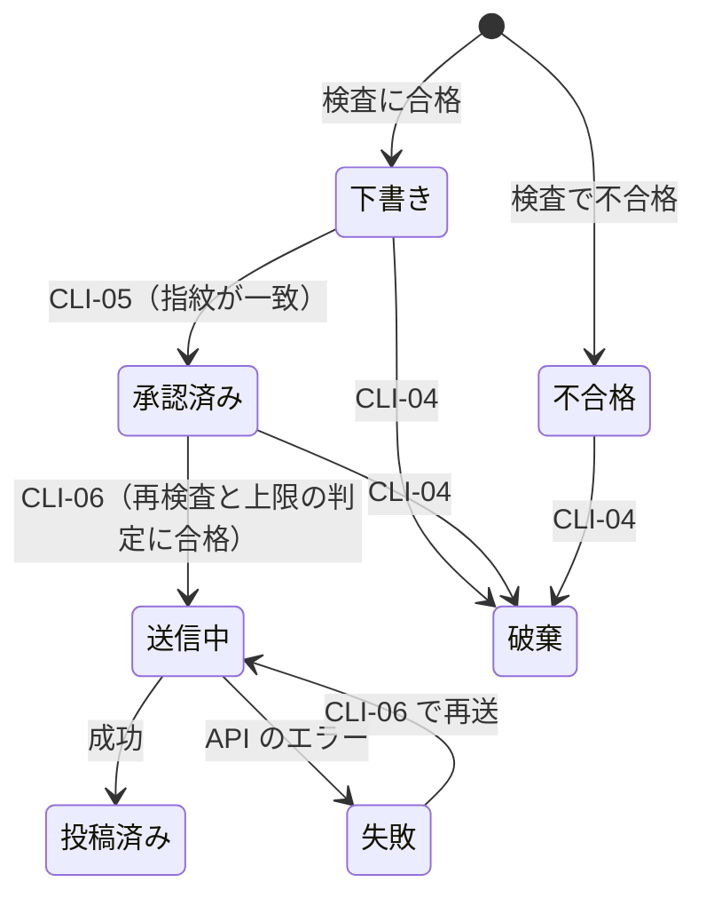

# 2a. 基本設計（外部）

## 2a.1 コマンド（CLI、CMP-C01）

コマンド名は `nukosns`。運営者と Claude Code が使う。

| ID | コマンド | 内容 | 使う人 | 要件 |
| --- | --- | --- | --- | --- |
| CLI-01 | `nukosns draft add --channel x (--text TEXT \| --file PATH)` | 下書きを登録し、検査の結果・費用の見積もり・番号・指紋を表示する | Claude Code | FR-06 |
| CLI-02 | `nukosns draft list [--status STATUS]` | 下書きの一覧を表示する。STATUS は `rejected`・`pending`・`approved`・`sending`・`published`・`failed`・`discarded` | 両方 | FR-06 |
| CLI-03 | `nukosns draft show ID` | 下書きの全文・検査の結果・費用・指紋・状態を表示する | 両方 | FR-06 |
| CLI-04 | `nukosns draft discard ID` | 下書きを破棄する（投稿済みのものは破棄できない） | 両方 | FR-06 |
| CLI-05 | `nukosns approve ID FINGERPRINT` | 下書きを承認する。指紋が今の文章と一致しないと承認しない | **運営者だけ**（EIF-09） | FR-07 |
| CLI-06 | `nukosns publish ID` | 承認済みの下書きを投稿する | 両方 | FR-07、FR-08 |
| CLI-07 | `nukosns measure` | 計測を 1 回実行する（Scheduler もこれを呼ぶ） | 両方、Scheduler | FR-01〜FR-05 |
| CLI-08 | `nukosns cost [--month YYYY-MM]` | その月の費用の合計・上限・残りを表示する | 両方 | FR-09、UC-03 |
| CLI-09 | `nukosns log [--tail N]` | 実行の記録を表示する | 両方 | FR-12 |

- **指紋**：下書きの文章とチャネルから作るハッシュ（SHA-256）の先頭 8 文字。CLI-01・CLI-03 で表示する。
- **終了コード**：0 = 成功、1 = 業務上の拒否（検査の不合格、上限超過、承認なし、指紋の不一致）、2 = 使い方の誤り、3 = 外部の失敗（API、保存先）。
- 下書きは書き換えない。直すときは新しく登録し、古いものを破棄する（承認と文章の対応を崩さないため）。

### 下書きの状態

- 「送信中」のまま止まった下書き（途中で落ちた場合）は、自動では再送しない。CLI-06 は「送信中」を拒否し、運営者が X の画面で投稿の有無を確かめる（NFR-06）。

## 2a.2 外部インターフェース（EIF）

| ID | 相手 | 内容 | 構成要素 |
| --- | --- | --- | --- |
| EIF-01 | X API（RES-01） | OAuth 1.0a のユーザーコンテキスト。`GET /2/users/me`（アカウントの数字）、`GET /2/users/{id}/tweets`（直近 29 日の投稿。`public_metrics` と `non_public_metrics`）、`POST /2/tweets`（投稿）。本人だけの数字は投稿から 30 日以内しか取れないため 29 日に絞る | CMP-A01 |
| EIF-02 | 保存先（RES-03） | `~/fukugyononuko/data/fukugyononuko-social/nukosns.sqlite` | CMP-A02〜A04 |
| EIF-03 | 設定（RES-05） | 同じフォルダの `settings.toml`。単価表（チャネル × 操作、ドル）、為替（初期値 1 ドル＝170 円）、月の上限（初期値 500 円）、禁止語のファイルの場所、集計の書き出し先 | CMP-A06、CMP-A05 |
| EIF-04 | 禁止語（RES-05） | ホームページのリポジトリの `.privacy-denylist`（1 行に 1 語、`#` で始まる行は注釈）。原本を 1 か所にするため、そのまま読む | CMP-A06 |
| EIF-05 | 運営者のノート（RES-04） | `vault/50-Metrics/SNS.md`。計測のたびに全体を書き直す。手で編集しない。憲章の実績表へは運営者側で転記する | CMP-A05 |
| EIF-06 | 認証情報（RES-06） | macOS キーチェーン。アカウント `fukugyononuko`、サービス `x-api-key`・`x-api-key-secret`・`x-access-token`・`x-access-token-secret` | CMP-U01 |
| EIF-07 | ログ（RES-07） | 同じフォルダの `logs/nukosns.log`。1 行 1 件の JSON（時刻、コマンド、結果、件数、費用）。認証情報・文章の全文は書かない | CMP-U02 |
| EIF-08 | launchd | `~/Library/LaunchAgents/com.fukugyononuko.nukosns.measure.plist`。毎週月曜 9:00 に CLI-07 を実行する。眠っていた場合は起きたときに実行される | CMP-C02 |
| EIF-09 | Claude Code の権限設定 | `~/fukugyononuko/.claude/settings.json` の `permissions.deny` に、承認のコマンド（CLI-05）を入れる。承認は運営者が `!` を付けて自分で実行する | CMP-C01 |

## 2a.3 集計の書き出し（EIF-05）の中身

| 節 | 内容 |
| --- | --- |
| 月ごと | 月、チャネル、フォロワー、フォロー、その月の投稿数、表示、いいね、プロフィールのクリック、リンクのクリック、その月の費用 |
| 直近 29 日の投稿 | 日付、チャネル、表示、いいね、プロフィールのクリック、本文の冒頭 |
| 最後の計測 | 時刻、成功・失敗 |
