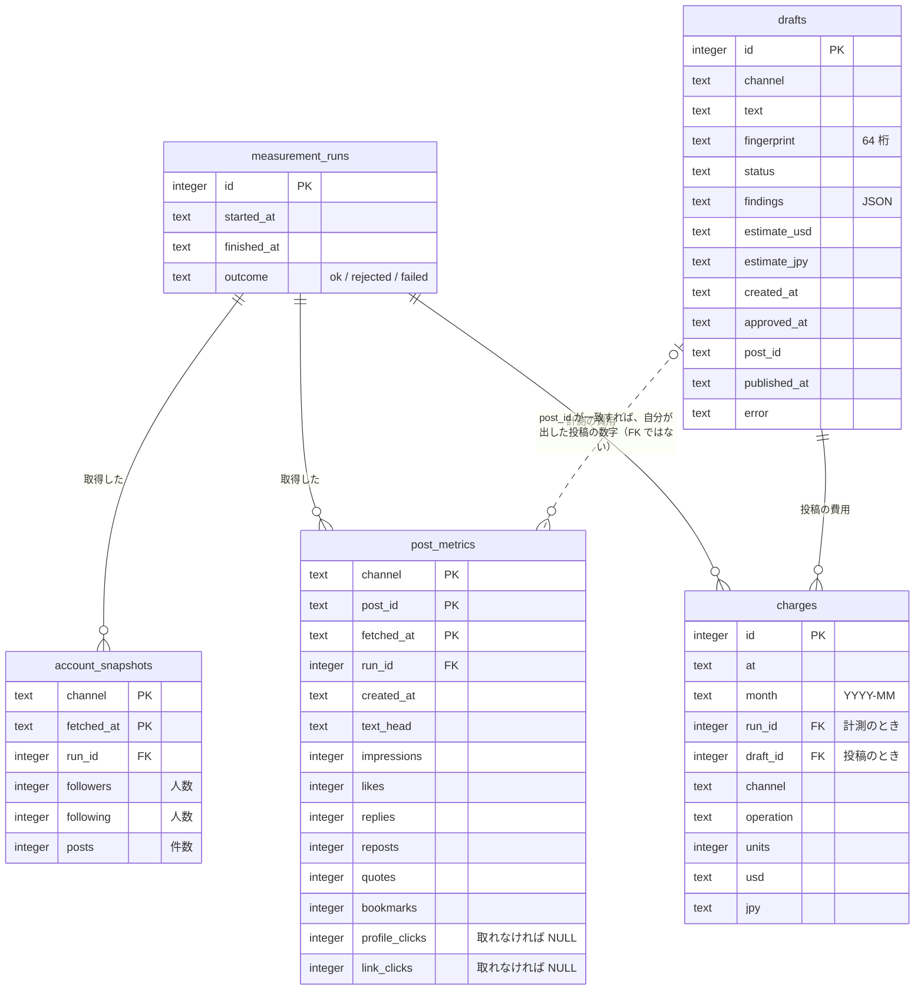

# 3. 詳細設計

## DD-01 依存とパッケージ構成

- 実行時の依存は **標準ライブラリだけ**（`sqlite3`、`tomllib`、`urllib`、`hashlib`、`hmac`、`unicodedata`、`argparse`）。投稿できる権限を持つ道具なので、サプライチェーンの攻撃面を小さくする（BR-06）。開発時だけ pytest・ruff・ty を使う。
- **構成要素ごとにパッケージを作り、契約と実装を同じ場所に置く**。`<層>/<構成要素>/__init__.py` に契約（`typing.Protocol`）、同じパッケージの別のモジュールに実装を置く。
- 値の型は `domain/` に、話題ごとに分けて置く。

```
src/fukugyononuko_social/
  domain/             # 値の型（DD-02）。どの層も import してよい
    channel.py  errors.py  secret.py  money.py  metrics.py  drafts.py
  utilities/          # CMP-U01 security/、CMP-U02 logging/、CMP-U03 clock/
  engines/            # CMP-E01 aggregation/、CMP-E02 draft_policy/、CMP-E03 cost/
  access/             # CMP-A01 channels/、A02 metrics/、A03 drafts/、A04 ledger/、A05 report/、A06 settings/
  managers/           # CMP-M01 measurement/、CMP-M02 publishing/
  clients/            # CMP-C01 cli/（CMP-C02 は deploy/launchd。DD-16）
  composition.py      # 具体的な実装を組み立てる唯一の場所（DD-15）
```

例：`engines/cost/__init__.py` に `CostEngine`（契約）、`engines/cost/default.py` に `DefaultCostEngine`（実装）。

**import の規則**（TC-A01、TC-A02 で検査する）：
- 契約は、利用規則（01 §1.6）で呼んでよい層からだけ import できる。
  - Engine → ResourceAccess・Utility
  - ResourceAccess → Utility
  - Manager → Engine・ResourceAccess・Utility
  - Client → Manager・Utility
- 同じ層の、別の構成要素の契約は import できない（Utility を除く）。
- 実装は、同じ構成要素の中と `composition.py` からだけ import できる。

## DD-02 主な型（`domain/`）

すべて `frozen=True` の dataclass。金額は `Decimal`。**状態によって持つ項目が変わるものは、直和型（`type X = A | B`）で表す**。そうすると、ありえない状態（「下書きなのに投稿 ID がある」など）を型の上で作れない。状態で分岐するときは `match` と `assert_never` を使い、扱い漏れを ty に検出させる。

| モジュール | 型 |
| --- | --- |
| `channel.py` | `Channel`（列挙：`X`。将来 `THREADS` など）、`month_of`（日本時間の YYYY-MM） |
| `errors.py` | `Outcome`（ok / rejected / failed）、`BusinessRejection`、`UsageError`、`ExternalFailure`（DD-18） |
| `secret.py` | `Secret`：`repr`・`str`・`format` は `Secret(***)`。保存・複製（pickle）はできない（DD-13） |
| `money.py` | `Usage`（channel、operation、units）、`Cost`（usd、jpy、usages）、`Budget`、`BudgetStatus` |
| `metrics.py` | `AccountSnapshot`、`PostMetrics`、`MeasurementRun = Running \| Finished`、`MetricsHistory`、`MonthlyRow`、`Report` |
| `drafts.py` | `Finding`、`Verdict = Pass \| Fail`、`DraftState`、`Draft`、`DraftStatus`、`PublishedPost`、`fingerprint` |

**直和型にするもの**：

| 型 | 場合 | それぞれが持つ項目 |
| --- | --- | --- |
| `Verdict`（検査の結果） | `Pass` / `Fail` | Pass：注意の一覧。Fail：理由（1 件以上）と注意の一覧 |
| `DraftState`（下書きの状態） | `Rejected` / `Pending` / `Approved` / `Sending` / `Published` / `Failed` / `Discarded` | Rejected：理由。Approved・Sending：承認の時刻。Published：承認の時刻、投稿 ID、投稿の時刻。Failed：承認の時刻、エラー文 |
| `MeasurementRun`（計測 1 回分） | `Running` / `Finished` | Finished だけが、終了の時刻と結果を持つ |

`PostMetrics` の `None`（チャネルによって取れない数字）は、状態ではなくデータの欠けなので、Optional のままにする。`Draft` は、変わらない項目（番号、チャネル、文章、指紋、注意、見積もり、作成の時刻）と、`state: DraftState` を持つ。保存先の行と直和型の変換は、CMP-A03（DraftAccess）の中で 1 回だけ行う。

## DD-03 保存先のスキーマ（SQLite、EIF-02）



### 表の一覧

MUTABLE は UPDATE か DELETE がある表、IMMUTABLE は INSERT だけの表。

| 表 | 可変性 | 許す操作 | 内容・理由 |
| --- | --- | --- | --- |
| `measurement_runs` | MUTABLE | INSERT、UPDATE（`finished_at`・`outcome` を 1 回だけ） | 計測 1 回分。開始時に行を作り、終了時に結果を書く（途中で落ちても、開始したことが残る） |
| `account_snapshots` | IMMUTABLE | INSERT | アカウントの数字。値が変わったら、新しい時刻の行として足す |
| `post_metrics` | IMMUTABLE | INSERT | 投稿ごとの数字。同上 |
| `drafts` | MUTABLE | INSERT、UPDATE（状態と、承認・投稿の結果の列だけ。DD-04） | 下書き。文章と指紋は変えない。破棄も DELETE ではなく状態で表す |
| `charges` | IMMUTABLE | INSERT | 費用の記録。訂正が必要なら、打ち消しの行を足す |
| `schema_version` | MUTABLE | UPDATE（スキーマの移行のときだけ） | スキーマの版 |

- IMMUTABLE の表には、UPDATE と DELETE を拒否するトリガー（`BEFORE UPDATE`・`BEFORE DELETE` で `RAISE(ABORT)`）を付けて、データベースの側でも守る。
- IMMUTABLE の表は過去の値を残すので、伸び方を時系列で追える。

- **`followers`・`following`・`posts` は人数・件数**。フォロワーの名前や一覧は取らない（要件にないうえ、一覧の取得は 1 件ごとに課金され、他人の情報を持つことにもなるため）。
- `charges` は `run_id` と `draft_id` のどちらか一方だけを持つ。
- `post_metrics.post_id` と `drafts.post_id` は外部キーにしない。手で投稿したものも計測するため。
- 時刻は UTC の ISO 8601 の文字列。金額は `Decimal` の文字列。`schema_version` 表（列は version だけ）で、スキーマの版を管理する。
- 同じ時刻の取得をもう一度保存しても、主キーで重複しない（NFR-05）。

## DD-04 下書きの状態遷移（CMP-A03）

状態は直和型 `DraftState`（DD-02）で表す。保存先には状態の名前（`DraftStatus`）と、その状態が持つ項目を列に書く。許す遷移だけを表で持ち、`UPDATE drafts SET status = 新 WHERE id = ? AND status = 旧` の形で更新する。更新した行が 0 なら拒否する。2 つの実行が同時に送ろうとしても、片方しか「送信中」にできない（NFR-06）。

| 旧 | 新 |
| --- | --- |
| 下書き | 承認済み、破棄 |
| 承認済み | 送信中、破棄 |
| 送信中 | 投稿済み、失敗 |
| 失敗 | 送信中 |
| 不合格 | 破棄 |

## DD-05 指紋

`contracts.fingerprint` で `sha256(channel + "\n" + NFC(text))` を計算し、16 進 64 桁を保存して、先頭 8 桁を表示する。承認では、入力された 8 桁と保存された値の先頭を比べ、さらに今の文章から計算し直した値とも比べる（保存後に文章が変わっていないことを確かめる）。

## DD-06 文字数（CMP-E02、X）

X の公式の数え方（[Counting characters](https://docs.x.com/fundamentals/counting-characters)、twitter-text の設定 v3）に従う。

1. 文章を NFC に正規化する。
2. URL は 1 つにつき 23 と数える。
3. ほかの文字は、コードポイントが 0〜4351、8192〜8205、8208〜8223、8242〜8247 なら 1、それ以外は 2 と数える。
4. 合計が 280 を超えたら不合格。

**安全側に寄せる簡略化**：
- 絵文字の結合（ZWJ・肌色の修飾子）は、まとめずに 1 コードポイントずつ数える。多めに数えるので、上限を超えた投稿を通すことはない。
- URL は、`http(s)://` で始まるものに加えて、「英数字 . 英字 2 文字以上」の形（例：`example.com`）も URL とみなす。多めに URL と判定すると、費用の見積もり（URL 付きの投稿の単価）も高めになる。

## DD-07 禁止語の照合（CMP-E02）

- 文章と禁止語を両方 NFKC に正規化し、小文字にして部分一致で照合する。1 つでも一致したら不合格。
- 不合格の理由には、禁止語そのものを出さず、禁止語ファイルの何行目に一致したかだけを示す。
- 禁止語ファイルが読めない、または空のときは、すべての下書きを不合格にする（読めないまま投稿しない）。

## DD-08 費用（CMP-E03）

- 単価は `settings.toml` の単価表から読む（VOL-02）。円は `ドル × 為替` を 1 円単位に切り上げる。
- 「月」は日本時間（Asia/Tokyo）で区切る（`contracts.month_of`）。保存する時刻は UTC のまま。
- `afford`：`今月の合計 + 今回の見積もり ≤ 上限`。
- 計測の前の見積もり（`usage_upper_bound`）は、ユーザーの読み取り 1 件と、投稿の読み取り 100 件で見積もる。
- 本人のデータの割引（Owned Reads）が当たるかどうかは確かめられないので、単価表は割引のない単価で始める。実際の請求と比べて、高すぎれば直す。

初期の単価表（2026-10-12 に [公式の料金ページ](https://docs.x.com/x-api/getting-started/pricing) で確認）：

| 操作（operation） | X の名前 | 単価 |
| --- | --- | --- |
| `user_read` | User: Read | $0.010 / 件 |
| `post_read` | Posts: Read | $0.005 / 件 |
| `post_create` | Post: Create | $0.015 / 回 |
| `post_create_with_url` | Post: Create (with URL) | $0.200 / 回 |

## DD-09 X との通信（CMP-A01）

- OAuth 1.0a（HMAC-SHA1、RFC 5849）で署名する。HTTP は `urllib`。タイムアウトは 30 秒。
- **再試行**：GET は、429・5xx・タイムアウトのときだけ、最大 2 回まで再試行する（合計 3 回）。
  - 待ち時間は指数バックオフ：1 回目の前は 2 秒、2 回目の前は 4 秒。それぞれ ±20% の揺らぎ（ジッター）を加える。
  - 429 の応答に `x-rate-limit-reset`（制限が解ける時刻）があれば、それまで待つ。ただし 60 秒より先なら待たずに失敗とする（`ExternalFailure`）。
  - 4xx（429 以外）は再試行しない。
- **冪等性**：
  - GET は読み取りだけなので、再試行しても X 側の状態は変わらない。再試行で費用が二重にかかる可能性はある（同じものを 24 時間以内に取り直すと課金されないことがある、と公式にあるが、保証はない）。そこで、費用は 2xx の応答ごとに記録する。
  - 計測をまるごと再実行しても、追記の表と「投稿ごとに最新の値だけを使う」集計（DD-10）により、集計は重複しない（NFR-05）。
  - POST（投稿）は再試行しない。X の投稿 API に、重複を防ぐキー（冪等キー）の仕組みは見当たらない（未確認）。そのため、二重投稿は下書きの状態遷移で防ぐ（DD-04）。応答が返らないまま終わった場合は「送信中」のまま残り、自動では再送しない（運営者が X の画面で確かめる）。
- 投稿の取得は `start_time` を「今 − 29 日」、`max_results=100`、`exclude=retweets` にして、`next_token` がなくなるまでページをめくる。
- 応答の `public_metrics` と `non_public_metrics` を、共通の項目名（02b §2b.3）に揃える。

## DD-10 集計（CMP-E01）

- 月は日本時間で区切る（DD-08）。
- 投稿：投稿ごとに `fetched_at` が最大の行だけを使い、`created_at` の月ごとに合計する。
- アカウント：月ごとに、その月の最後の取得値を使う。
- 費用：`charges` を月ごとに合計する。
- 最後の計測：`measurement_runs` の最新の行。
- 直近の投稿：作成から 29 日以内の投稿を、表示の多い順に並べる。同じ値どうしは投稿 ID の順にする（並び順を一意に決める。決まり 11）。

## DD-11 集計の書き出し（CMP-A05）

同じフォルダに一時ファイルを書いてから、名前を置き換える。書いている途中のファイルを Obsidian が読んでしまうのを防ぐ。表の中の `|` は全角に置き換える。

## DD-12 設定（CMP-A06、EIF-03）

リポジトリには `settings.example.toml` を置く。実際の設定ファイルがないときは、作り方を示して終了コード 2 で止まる。

```toml
[budget]
monthly_cap_jpy = 500
usd_jpy = 170

[paths]
denylist = "~/fukugyononuko/projects/fukugyononuko.github.io/.privacy-denylist"
report = "~/fukugyononuko/vault/50-Metrics/SNS.md"

[prices.x]  # ドル。DD-08
user_read = "0.010"
post_read = "0.005"
post_create = "0.015"
post_create_with_url = "0.200"
```

## DD-13 認証情報（CMP-U01）

- `security find-generic-password -a fukugyononuko -s <サービス> -w` で読む。値は `Secret` に包んで返す。
- 失敗したときのエラー文には、サービス名だけを出す（コマンドの出力は出さない）。

## DD-14 ログ（CMP-U02、EIF-07）

1 行 1 件の JSON：`at`、`command`、`outcome`（ok / rejected / failed）、`detail`（件数、費用、下書きの番号など）。文章の全文と認証情報は書かない。

## DD-15 組み立てと CLI（CMP-C01）

- `composition.py` だけが具体的な実装（X 用の ChannelAccess、SQLite、キーチェーンなど）を知っている。動かす場所を変えるときは、ここで差し替える（VOL-08〜VOL-12）。
- CLI は `argparse` で作り、例外を終了コードに変換する：`BusinessRejection` → 1、`UsageError` → 2、`ExternalFailure` → 3。
- `pyproject.toml` の `[project.scripts]` に `nukosns = "fukugyononuko_social.clients.cli:main"` を登録する。

## DD-16 定期実行（CMP-C02、EIF-08）

- `deploy/launchd/com.fukugyononuko.nukosns.measure.plist` を雛形として置き、`scripts/install_launchd.py` で `~/Library/LaunchAgents/` に置いて読み込む。
- `StartCalendarInterval` を月曜（`Weekday` 1）の 9:00 にする。眠っていた場合は、起きたときに launchd が実行する。
- 実行するのは `uv run --project <リポジトリ> nukosns measure`。標準出力と標準エラーは、ログのフォルダに書く。

## DD-17 承認の制限（EIF-09）

`~/fukugyononuko/.claude/settings.json` の `permissions.deny` に次を入れる。承認は、運営者が `!` を付けて自分で実行する。

```json
["Bash(nukosns approve:*)", "Bash(uv run nukosns approve:*)", "Bash(uv run --project * nukosns approve:*)"]
```

パターンの書き方（途中の `*` が使えるか）は、実装のときに Claude Code の公式ドキュメントで確かめる。

これは、Claude Code が誤って承認することを防ぐ仕組み。指紋（DD-05）と合わせて、承認は「運営者が見た文章そのもの」に結びつく。

## DD-18 例外

| 例外 | 意味 | 終了コード |
| --- | --- | --- |
| `BusinessRejection` | 検査の不合格、上限の超過、承認なし、指紋の不一致、許されない遷移 | 1 |
| `UsageError` | 引数の誤り、設定ファイルがない | 2 |
| `ExternalFailure` | API・キーチェーン・保存先の失敗 | 3 |
